# STRATEGIC INVESTMENT PROPOSAL & BOARD MEMORANDUM

**TO:** Chief Executive Officer (CEO) & Board of Directors  
**FROM:** Chief Technology Officer (CTO) & Chief Financial Officer (CFO)  
**DATE:** 9 November 2026  
**SUBJECT:** Commercial & Operational Proposal for 50-Site GIDA Fixed Wireless Access (FWA) Expansion  
**RECOMMENDED COMMERCIAL ARCHITECTURE:** **Option 2 (Mechanism 2: Affordable GIDA Social-First Pricing & Solar OPEX Optimization)**  

---

## 1. Executive Summary: The Strategic Opportunity

We propose entering a public-private partnership with the Department of Information and Communications Technology (DICT) to deploy and operate a **50-site 5G NR Band n50 (1.5 GHz / 1432–1517 MHz TDD) Fixed Wireless Access (FWA) broadband network** across high-density unserved and underserved rural communities (GIDAs) in the Philippines.

```
========================================================================================
THE CEO SCORECARD: 50-SITE OPTION 2 STRATEGIC OVERVIEW
========================================================================================
Company Upfront Infrastructure CAPEX:   PHP 0.00 (100% Funded by Non-Recoverable DICT Grant)
Government Capital Grant:               USD 12.795 Million (PHP 767.69 Million excl. VAT)
Total Addressable Market:               175,820 Estimated Households (473 Barangays / 836k Pop)
Average Addressable Market per Site:    3,516 Households per Base Station (6.0 km radius)
Retail Pricing Strategy (Option 2):     Blended ₱709.00 / month Gross (₱499 Social to ₱1,299 Biz)
Net Cash Margin per Connected Home:     ₱599.04 / month (₱7,188.54 / year) after taxes & fees
Company Fixed Annual Operating Burden:  PHP 195.12 Million / year (Solar-Hybrid Offsets 60% Power)
Break-Even Market Share (w/ Anchor):    11.2% Household Penetration (19,631 Homes = 393 / site)
Target +20% Operating Margin (w/ Anchor): 14.0% Household Penetration (24,539 Homes = 491 / site)
Annual EBITDA at 20% Penetration:       +PHP 100.08 Million / year (+51.3% Return on Operating Cost)
Downside Capital Risk to Company:       Zero Asset Stranding; Equipment Funded by State Grant
========================================================================================
```

### Strategic Value Drivers for Our Business
1. **Zero Upfront Balance Sheet Exposure**: The government infuses **100% of the base station infrastructure CAPEX (`$12.795M` / `₱767.69M`)** and customer premises equipment (CPE) as a **non-recoverable public grant**. We do not amortize or repay this capital.
2. **Eliminated Core Software Outlay**: By negotiating a pay-as-you-grow arrangement with the Core Network supplier at **₱10.00/subscriber/month**, we avoided `$2.805M` (`₱168.30M`) in Day-1 software license commitments.
3. **Engineered Energy Savings**: By mandating **16kW solar arrays and 450AH lithium-ion battery banks** in the government-funded CAPEX, we slashed our site electricity and diesel costs by 60%, reducing our fixed annual cash OPEX from `₱288.0M` to **₱195.12M / year** (`₱325,200 / site / month`).
4. **Low Penetration Hurdle to Profitability**: At our recommended **Affordable GIDA pricing (`₱709.00/mo` blended)**, we break even at just **11.2% household penetration (393 homes/site)** with an LGU anchor contract, and generate a **+20% net commercial margin at only 14.0% market share (491 homes/site)**. Over **85% of the covered households remain as untapped growth upside**.

---

## 2. Deal Structure & Commercial Framework

The transaction is structured under a Government-Assisted Infrastructure & Partner-Operated Concession:

```mermaid
flowchart LR
    subgraph State["DICT & Government (Capital Partner)"]
        S1["Provides 100% Non-Recoverable CAPEX Grant: ₱767.69M Infra"]
        S2["Funds Household CPE Kits @ $55/unit as Demand Develops"]
        S3["Provides Free Co-Location on Existing Government Towers"]
        S4["Awards 6 LGU/School Anchor Endpoints/Site @ ₱15k/mo (₱54M/yr)"]
    end

    subgraph Company["Our Operating Company (Commercial Partner)"]
        C1["Zero Debt Incurred for Base Station Infrastructure"]
        C2["Funds Solar-Optimized Site OPEX (₱195.12M/yr)"]
        C3["Pays Variable ₱10/mo Core Fee + ₱5/mo Regulatory SUF"]
        C4["Collects 100% of Recurring Retail & Enterprise Subscription Tariffs"]
    end

    subgraph Cash["Commercial Cash Flows"]
        R1["Blended Revenue: ₱709.00/mo Gross per Home"]
        R2["Net Cash Kept: ₱599.04/mo per Home (₱7,188/yr)"]
        R3["OPEX Break-Even: 19,631 Homes (11.2% Penetration)"]
        R4["EBITDA at 20% Penetration: +₱100.08 Million / year"]
    end

    State --> Company
    Company --> Cash
```



### Capital & Legal Terms
- **Asset Ownership**: Government retains legal title to all procured physical assets (monopoles, solar plants, base station hardware).
- **Concession Period**: 5-year renewable operating license with exclusive commercial service rights across the 50 qualified clusters.
- **Spectrum Authorization**: NTC provisional authority for 20–40 MHz in 5G NR Band n50 (1432–1517 MHz TDD).
- **Regulatory SUF**: Capped at a simplified **₱5.00 per active subscriber per month** (waiving complex station/bandwidth fees).

---

## 3. Product Pricing & Unit Margin Economics (Option 2)

Option 2 adopts an **Affordable GIDA Social-First Pricing Mix** tailored to disposable household income in rural municipalities. By eliminating capital depreciation, our unit margins remain exceptionally high:

| Service Plan Tier | Target Speed & SLA | Monthly Retail Price | Target Subscriber Mix | Monthly Cash Contribution |
| :--- | :--- | ---: | ---: | ---: |
| **Tier 1: Social Lifeline** | Up to 25 Mbps DL / 5 Mbps UL | **₱499.00 / month** | **40%** (Low-income households) | ₱199.60 / HH |
| **Tier 2: Standard Family** | Up to 50 Mbps DL / 10 Mbps UL | **₱699.00 / month** | **45%** (Mainstream residential) | ₱314.55 / HH |
| **Tier 3: Microenterprise** | Up to 100 Mbps DL / 20 Mbps UL | **₱1,299.00 / month** | **15%** (Sari-sari stores, clinics, co-ops) | ₱194.85 / HH |
| **BLENDED RETAIL MIX** | **Weighted Average Revenue** | **₱709.00 / month** | **100%** | **₱709.00 / month** |

### Net Cash Flow per Subscriber (Unit Contribution Bridge)
Every customer generates a net annual cash contribution of **₱7,188.54 / year** directly to our bottom line:

```
Gross Advertised Retail Tariff:          ₱709.00 / month
  Less: 12% Value Added Tax (VAT):       -₱75.96  (statutory pass-through)
  Less: 3% Collection & Bad Debt Risk:   -₱19.00  (conservative rural allowance)
----------------------------------------------------------------------------------------
Net Collected Cash Revenue:              ₱614.04 / month
  Less: Regulatory SUF (in lieu of NTC):  -₱5.00  (fixed regulatory cost)
  Less: Pay-As-You-Grow Core Software:   -₱10.00  (Core software supplier fee)
========================================================================================
NET OPERATING CONTRIBUTION MARGIN:       ₱599.04 / month (84.5% Net Margin on Gross)
ANNUAL OPERATING CASH FLOW PER USER:     ₱7,188.54 / year per paying household
========================================================================================
```

---

## 4. Financial Projections & Break-Even Sensitivity

The 50 sites encompass **175,820 addressable households** across 473 barangays (averaging 3,516 households per site). Our financial projections model both a standalone retail scenario and our recommended structure backed by a government anchor contract:

```
========================================================================================================================
FINANCIAL PERFORMANCE BY HOUSEHOLD PENETRATION (50 SITES | 175,820 ADDRESSABLE HOMES)
========================================================================================================================
Market      Connected     Average Subs    Annual Net       Case A: Standalone Retail      Case B: Retail + LGU Anchor
Share %     Households    Per BTS Site    Retail Revenue   Annual EBITDA   OPEX ROI %     Annual EBITDA    OPEX ROI %
------------------------------------------------------------------------------------------------------------------------
 5.0%        8,791 HHs     176 / site      ₱63.19M         (₱131.93M)       -67.6%         (₱77.93M)        -40.0%
10.0%       17,582 HHs     352 / site     ₱126.39M          (₱68.73M)       -35.2%         (₱14.73M)         -7.5%
11.2%       19,631 HHs     393 / site     ₱141.12M          (₱54.00M)       -27.7%         ₱0.00M [BE]        0.0%
14.0%       24,539 HHs     491 / site     ₱176.40M          (₱18.72M)        -9.6%        +₱35.28M [+20%]   +18.1%
15.4%       27,143 HHs     543 / site     ₱195.12M          ₱0.00M [BE]      0.0%         +₱54.00M          +27.7%
19.3%       33,929 HHs     679 / site     ₱243.90M         +₱48.78M [+20%]  +25.0%        +₱102.78M         +52.7%
20.0%       35,164 HHs     703 / site     ₱252.78M         +₱57.66M         +29.5%        +₱111.66M         +57.2%
25.0%       43,955 HHs     879 / site     ₱315.97M        +₱120.85M         +62.0%        +₱174.85M         +89.6%
30.0%       52,746 HHs   1,055 / site     ₱379.16M        +₱184.04M         +94.3%        +₱238.04M        +122.0%
========================================================================================================================
```

### Executive Takeaways from the Financial Model
1. **Case B: Retail + Institutional LGU Anchor (`₱54.0M/yr`) — Recommended Base Case**:
   - **Break-Even**: Reached at **19,631 households (393 per site)**, representing just **11.2% of the local market**.
   - **Target Operating Profit**: At **14.0% penetration (491 homes per site = 24,539 total)**, the business generates **₱35.28 million / year** in net operating profit (a 20.0% net margin).
   - **Mature Potential**: At a modest **20.0% penetration (703 homes per site = 35,164 total)**, the project produces **+₱111.66 million / year in clean EBITDA**.
2. **Case A: Standalone Retail (Conservative Downside with Zero Anchor Revenue)**:
   - Even if the government contracts zero institutional endpoints, our break-even is achieved at **27,143 households (543 per site = 15.4% penetration)**.
   - We hit our standard **+20% operating margin at 33,929 households (679 per site = 19.3% penetration)**.

---

## 5. Risk Assessment & Mitigation Matrix

| Strategic Risk | Probability | Financial Impact | Engineered Mitigation Strategy |
| :--- | :--- | :--- | :--- |
| **Grid Power Instability & Diesel Inflation** | High | Severe | **Mitigated in CAPEX**: The 16kW solar PV array and 450AH lithium-ion storage bank eliminate 60% of power costs. System runs autonomously on solar during daylight and battery at night. |
| **High Customer Acquisition Cost (CAC)** | Medium | Moderate | **CPEs 100% Grant-Funded**: DICT absorbs the $55 CPE cost per household. Customers receive terminal hardware on a loan basis, eliminating subscriber upfront friction. |
| **Core Network Software Stranding** | Low | Severe | **Zero License Commitments**: Replaced the traditional $2.805M upfront core purchase with a variable ₱10.00/sub/month fee. If subscribers churn, software costs decline proportionally. |
| **Backhaul Bottlenecks & Fiber Delays** | High | Moderate | **Turnkey LEO Satellite**: Every site is provisioned with 4 bonded Starlink LEO terminals delivering 600 Mbps immediate backhaul, bypassing civil fiber delays. |
| **Tower Lease Cost Escalation** | Low | Low | **Free Government Co-Location**: Sites utilize existing public towers and properties with long-term zero-lease inter-agency easements. |

---

## 6. Implementation Timeline & Capital Tranches

The 50 sites will roll out across four controlled tranches over a 9-month mobilization:

```
Tranche 1 (Months 1-3):   Pilot Deployment (5 Sites — Sulu & Maguindanao GIDA Clusters)
                         • Validate 5G NR n50 radio link budget & Starlink backhaul bonding.
                         • Onboard initial 3,500 subscribers; verify billing & OSS/BSS integration.

Tranche 2 (Months 4-5):   Regional Expansion (15 Sites — Lanao del Sur, Lanao del Norte, Palawan)
                         • Target: 6,500 subscriber connections; onboard regional field maintenance teams.

Tranche 3 (Months 6-7):   Visayas & Zamboanga (15 Sites — Samar, Eastern Samar, Zamboanga)
                         • Target: 6,500 subscriber connections; establish localized customer service desks.

Tranche 4 (Months 8-9):   Final Tranche (15 Sites — Bicol, Caraga, Ilocos, Benguet)
                         • Full 50-site commercial operations achieved; target 22,000+ paying connections.
```

---

## 7. Recommended Board Resolution & Next Steps

We recommend that the Board of Directors authorize management to:

1. **Submit Formal Proposal to DICT**: Deliver the formal proposal for the **50-Site GIDA FWA Network Expansion based on Option 2 (Affordable GIDA Pricing & Solar OPEX)** to the Office of the Secretary, DICT.
2. **Execute Public Grant Agreement**: Enter into negotiations for the **USD 12.795 Million (PHP 767.69M) non-recoverable capital grant** covering base station infrastructure, solar arrays, and demand-led CPE funding.
3. **Secure Institutional Anchor Contract**: Finalize terms with DICT under RA 10929 for the **₱54.00M/year wholesale anchor contract** (6 endpoints per site across 50 sites @ ₱15,000/mo).
4. **Finalize Pay-As-You-Grow Core Agreement**: Sign the definitive software contract with the Core Network vendor at **₱10.00 per active subscriber per month**, eliminating upfront core licenses.

---

### Supporting Documentation & Operational Assets
- **Word Proposal for Government Submission**: [DICT_50_Site_n50_FWA_Formal_Proposal.docx](file:///Users/olivertungol/Library/CloudStorage/OneDrive-Personal/Comclark/GIDA%20FWA/DICT_50_Site_n50_FWA_Formal_Proposal.docx)
- **Live Financial Model & Sensitivity Simulator**: [GIDA_n50_FWA_Portal.html](file:///Users/olivertungol/Library/CloudStorage/OneDrive-Personal/Comclark/GIDA%20FWA/GIDA_n50_FWA_Portal.html)
- **Master 12-Sheet Excel Financial Model**: [PH_Unserved_n50_Network_Plan_and_Cost_Model.xlsx](file:///Users/olivertungol/Library/CloudStorage/OneDrive-Personal/Comclark/GIDA%20FWA/PH_Unserved_n50_Network_Plan_and_Cost_Model.xlsx)
- **Project Documentation & Matrix Guide**: [README.md](file:///Users/olivertungol/Library/CloudStorage/OneDrive-Personal/Comclark/GIDA%20FWA/README.md)
